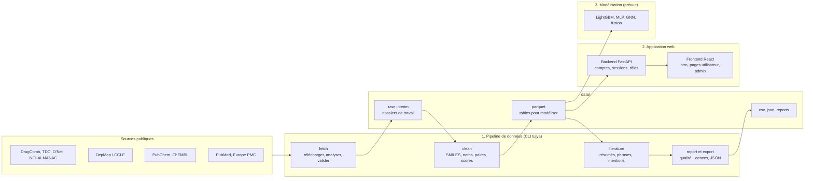
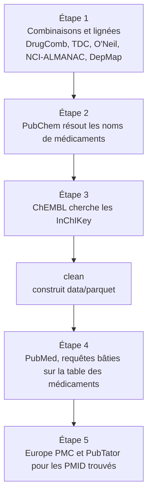
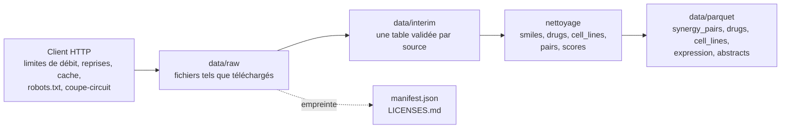
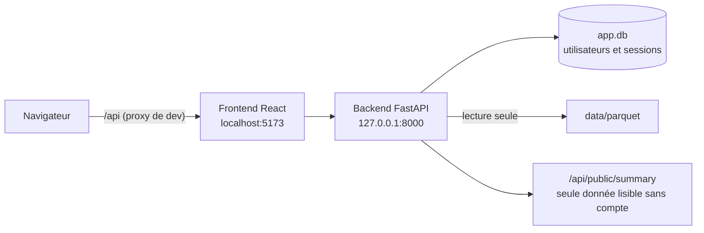
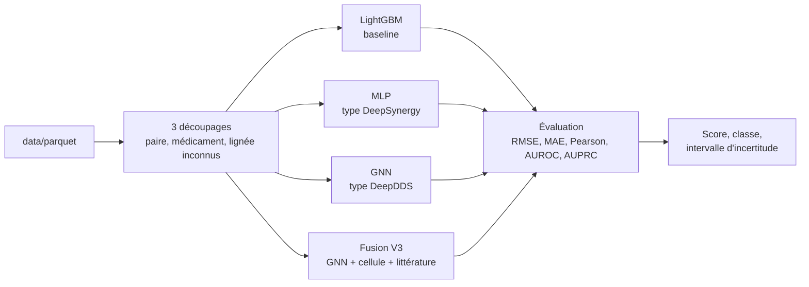

<div align="center">

# 💊 tujya-data

**Pipeline de collecte de données pour Tujya**

Prédire quelles combinaisons de médicaments agissent mieux ensemble sur des lignées de cancer,
en s'appuyant sur les données publiques et sur la littérature scientifique (PubMed).

`Python 3.11+` · `FastAPI` · `React` · `Parquet` · `Licences vérifiées`

🏫 TEK-UP University · 👥 **Équipe : Mohamed Raed Bouhali · Ilef Ben Hassen · Melek Bouabid**

</div>

> [!NOTE]
> Le pipeline collecte uniquement des données scientifiques **publiques**, de façon polie et reproductible :
> **API officielles d'abord**, fichiers officiels ensuite, **jamais de scraping HTML**.
> Ce n'est pas un scraper généraliste : il refuse de contacter tout site qui n'est pas dans sa liste de sources.

---

## 📑 Sommaire

| | Section | | Section |
|---|---|---|---|
| 🧱 | [Architecture](#architecture) | 🌐 | [Comportement réseau](#comportement-reseau) |
| 📦 | [Ce que vous obtenez](#ce-que-vous-obtenez) | ⏰ | [Planification et Docker](#planification-et-docker) |
| ⚙️ | [Installation](#installation) | 🖥️ | [Application web](#application-web) |
| ▶️ | [Utilisation](#utilisation) | 🛠️ | [Développement](#developpement) |
| 📚 | [Sources](#sources) | 🗂️ | [Structure du dépôt](#structure-du-depot) |

---

<a id="architecture"></a>

## 🧱 Architecture

Le projet a **trois couches**. Chacune lit uniquement la sortie de la précédente.

| Couche | Dossier | Rôle |
|---|---|---|
| 1️⃣ Pipeline de données | `src/tujya_data/` | Collecter, valider et nettoyer les données dans `data/` |
| 2️⃣ Application web | `backend/` et `frontend/` | Lire les tables de `data/parquet` et les servir avec comptes et rôles |
| 3️⃣ Modélisation 🟡 *prévue* | à venir | Entraîner et comparer les modèles sur les mêmes tables |

### 🔭 Vue d'ensemble



<a id="schema-pipeline"></a>

### 🔄 Le pipeline en 5 étapes

`fetch` travaille par étapes, car chaque étape a besoin du résultat de la précédente.



Dans chaque connecteur, les mêmes quatre étapes s'exécutent : `discover` → `fetch` → `parse` → `validate`.
Les fichiers bruts ne sont **jamais modifiés** ; le manifeste garde le SHA-256, la taille, l'URL, la version et la licence.



<a id="schema-application"></a>

### 🖥️ Application web



| Partie | Responsabilité |
|---|---|
| 🌍 Page d'introduction publique | Affiche seulement la taille des tables, sans compte |
| 🔐 Connexion / inscription | Un nouveau compte est toujours un utilisateur simple |
| 👤 Pages utilisateur (`/home`) | Accueil, médicaments, lignées, profil |
| 🛡️ Pages admin (`/admin`) | Tableau de bord, création d'administrateurs, rôles, mots de passe, désactivation et suppression |
| 🍪 Session | Cookie `HttpOnly` lié à une ligne en base : désactiver un compte le déconnecte aussitôt |
| ✅ Autorisation | Le rôle est vérifié par l'API à chaque requête |

### 🧠 Couche de modélisation 🟡 *prévue*

> [!WARNING]
> Cette couche **n'existe pas encore** dans ce dépôt. Elle lira `data/parquet` et comparera quatre modèles sous trois protocoles de validation, pour isoler l'effet de la littérature.



| Version | Entrées | Question posée |
|---|---|---|
| **V1** | Chimie seule | Que vaut la structure moléculaire seule ? |
| **V2** | Chimie + lignée | Qu'apporte le profil de la cellule ? |
| **V3** 🔬 | Chimie + lignée + littérature | **Les connaissances PubMed aident-elles, surtout pour un médicament jamais vu ?** |

La différence **V3 − V2**, répétée sur plusieurs graines, est le résultat scientifique principal.
Positif, nul ou négatif : tout est acceptable s'il est rapporté avec des chiffres.

> [!CAUTION]
> Les prédictions sont des **hypothèses in silico** à valider en laboratoire. Ce n'est jamais un conseil médical.

---

<a id="ce-que-vous-obtenez"></a>

## 📦 Ce que vous obtenez

Tout ce que produit le pipeline est dans **un seul dossier**, `data/`, avec un sous-dossier par format.
L'extension du fichier indique où il se trouve.

```
data/
  parquet/   les tables pour modéliser
  csv/       couverture, conflits, files de relecture, phrases à annoter
  json/      fichiers pour le frontend
  reports/   rapport qualité (Markdown et HTML), guide d'annotation

  raw/       fichiers tels que téléchargés, par source     interim/   une table validée par source
  manual/    fichiers que vous déposez vous-même           cache/ state/   suivi interne
```

<details>
<summary><b>📋 Détail des fichiers produits</b></summary>

| Fichier | Contenu |
|---|---|
| `data/parquet/synergy_pairs.parquet` | Une ligne par paire de médicaments, lignée, source et étude. Bliss, Loewe, HSA et ZIP dans des colonnes séparées |
| `data/parquet/drugs.parquet` | Une ligne par médicament : SMILES standardisé, InChIKey, PubChem CID, ChEMBL ID, synonymes, indicateur de validité |
| `data/parquet/cell_lines.parquet` | Noms, tissu, identifiant DepMap |
| `data/parquet/expression.parquet` | Matrice d'expression des lignées utilisées |
| `data/parquet/abstracts.parquet`, `candidate_sentences.parquet` | Résumés PubMed, et phrases citant au moins deux médicaments |
| `data/csv/coverage.csv`, `conflicts.csv`, `source_agreement.csv` | Médicaments et lignées distincts par source ; enregistrements en désaccord ; accord entre sources |
| `data/csv/drug_review_queue.csv`, `cell_line_review_queue.csv` | Noms qu'une personne doit vérifier |
| `data/csv/sample_sentences.csv` | Phrases stratifiées à annoter à la main (aussi `data/json/sample_sentences.jsonl`) |
| `data/json/*.json` | `drugs.json`, `cell_lines.json`, `mock_predictions_seed.json`, `citations.json` pour le frontend |
| `data/reports/data_quality.md` / `.html` | Rapport qualité ; `annotation_guide.md` explique les étiquettes |
| `manifest.json`, `LICENSES.md` | SHA-256, taille, URL, version, date de récupération et licence de chaque fichier |

</details>

📖 Chaque colonne est expliquée dans [docs/DATA_DICTIONARY.md](docs/DATA_DICTIONARY.md).

`data/raw` et `data/interim` sont les dossiers de travail du pipeline, avec un sous-dossier par source.
`manifest.json` et `LICENSES.md` sont à côté de `data/` : ils ne contiennent pas de données, ils
décrivent le dossier, et contrairement à `data/` ils peuvent être commités.
`--data-dir` déplace tout le dossier ; `parquet_dir`, `csv_dir`, `json_dir` et `reports_dir`
dans `config.yaml` permettent de déplacer un seul format.

---

<a id="installation"></a>

## ⚙️ Installation

Python **3.11 ou plus récent** requis.

```bash
python -m venv .venv
source .venv/bin/activate            # Windows PowerShell : .venv\Scripts\Activate.ps1
pip install -e ".[dev]"
cp .env.example .env                 # puis modifier .env
```

Renseignez deux valeurs dans `.env` (ignoré par git, jamais écrit dans les logs) :

| Variable | Obligatoire | Rôle |
|---|---|---|
| `CONTACT_EMAIL` | ✅ **oui** | Envoyé dans le User-Agent pour que les fournisseurs puissent vous joindre. Sans elle, les requêtes réelles sont refusées |
| `NCBI_API_KEY` | ➖ optionnelle | Gratuite depuis votre compte NCBI. Passe la limite E-utilities d'environ 3 à environ 10 requêtes par seconde |

Puis vérifiez la machine :

```bash
tujya preflight
```

---

<a id="utilisation"></a>

## ▶️ Utilisation

```bash
tujya fetch --sample 100 --dry-run   # affiche le plan, ne fait aucune requête ni écriture
tujya fetch --sample 100             # petit échantillon de chaque source activée
tujya fetch                          # exécution complète (environ 740 Mo pour l'étape 1)
tujya clean                          # construit les tables nettoyées (data/parquet)
tujya fetch --source pubmed --source europepmc
tujya literature                     # résumés, phrases candidates, échantillon à annoter
tujya report                         # rapport qualité, couverture, conflits, LICENSES.md
tujya export                         # JSON pour le frontend
tujya summary                        # rapport final de tout ce qui a été collecté
```

⚡ Ou tout en une fois, de façon incrémentale : `tujya update`.

Les étapes de `fetch` (voir le [schéma du pipeline](#schema-pipeline)) :

1. Combinaisons de médicaments et lignées : DrugComb, TDC, O'Neil, NCI-ALMANAC, DepMap.
2. PubChem résout les noms de médicaments trouvés à l'étape 1.
3. ChEMBL cherche les InChIKey renvoyés par PubChem.
4. PubMed, avec des requêtes bâties sur la table nettoyée des médicaments (**lancez donc `clean` avant**).
5. Europe PMC (accès libre) et PubTator, pour les PMID renvoyés par PubMed.

<details>
<summary><b>🧰 Toutes les commandes</b></summary>

| Commande | Ce qu'elle fait |
|---|---|
| `sources` | Liste les sources, licences et états. `--check` teste chaque lien et réécrit `docs/SOURCES.md` |
| `fetch` | Télécharge, analyse et valide dans `data/raw` et `data/interim`. Options : `--source`, `--sample N`, `--dry-run`, `--refresh` |
| `validate` | Revérifie les empreintes des fichiers bruts contre le manifeste et les lignes interim contre leurs schémas |
| `clean` | Construit les tables nettoyées dans `data/parquet` |
| `literature` | Stock de résumés, segmentation en phrases, mentions de médicaments, échantillon d'annotation |
| `report` | Rapport qualité, couverture, conflits, registre des licences |
| `export` | JSON pour le frontend |
| `status` | État de chaque connecteur et contenu du disque |
| `summary` | Rapport final de tout ce qui a été collecté (`--json` pour les machines) |
| `preflight` | Espace disque, permissions, identité, outils |
| `update` | Tout ce qui précède, de façon incrémentale. Pour cron ou CI |

Les options globales se placent avant la commande : `--config`, `--set clé=valeur`, `--data-dir`,
`--log-level`, `--text-logs`. Tout réglage de `config.yaml` peut être remplacé :

```bash
tujya --set sources.tdc.enabled=false --set "http.hosts[zenodo.org].rate=0.05" fetch
```

Les logs sont des lignes JSON sur stderr ; les tables et rapports vont sur stdout.

</details>

### 💸 Les relances sont peu coûteuses

Rien n'est téléchargé ni dupliqué deux fois :

- les fichiers bruts sont ignorés si leur empreinte correspond au manifeste ;
- les réponses d'API sont en cache et revalidées avec ETag / Last-Modified ;
- les recherches (y compris « introuvable ») sont mémorisées ;
- les téléchargements interrompus reprennent avec une requête HTTP Range ;
- PubMed n'est interrogé que pour les notices ajoutées depuis la dernière exécution.

---

<a id="sources"></a>

## 📚 Sources

| Source | Accès | Activée par défaut | Licence |
|---|---|---|---|
| **DrugComb v1.4** | Fichier Zenodo, version fixée | ✅ | CC BY 4.0 |
| **TDC DrugSyn** | Fichier Harvard Dataverse (chargé avec PyTDC si installé) | ✅ | CC BY 4.0 |
| **O'Neil / DeepSynergy** | CSV | ✅ | aucune indiquée : usage de recherche, ne pas redistribuer |
| **NCI-ALMANAC** | ✋ **téléchargement manuel** | ✅ | Travail du gouvernement américain |
| **DepMap / CCLE 24Q4** | API et fichiers Figshare+ | ✅ | CC BY 4.0 |
| **PubChem** | API PUG-REST | ✅ | domaine public |
| **ChEMBL** | API web services | ✅ | CC BY-SA 3.0 |
| **PubMed** | API E-utilities | ✅ | conditions NLM |
| **Europe PMC** | API REST | ✅ | conditions Europe PMC |
| GDSC (Cell Model Passports) | fichier | ⬜ | non vérifiée |
| DDInter | CSV, accès conditionné | ⬜ | CC BY-NC-SA 4.0 |
| DrugBank | ✋ **fichier que vous fournissez** | ⬜ | licence DrugBank |
| PubMed baseline | XML très volumineux, ✋ **téléchargement manuel** | ⬜ | conditions NLM |
| PubTator 3 | API | ⬜ | domaine public |

🔗 États des liens, points d'accès, limites de débit et résultats par source : [docs/SOURCES.md](docs/SOURCES.md).
Licences et citations : `LICENSES.md`.

### ✋ Étapes manuelles

> [!IMPORTANT]
> Certaines sources interdisent le téléchargement automatisé. Le pipeline ne contourne **jamais** ces règles.

- **NCI-ALMANAC.** Le robots.txt de `wiki.nci.nih.gov` interdit les téléchargements automatiques. Ouvrez la
  [page NCI-ALMANAC](https://wiki.nci.nih.gov/spaces/NCIDTPdata/pages/338237347/NCI-ALMANAC)
  dans un navigateur, enregistrez `ComboDrugGrowth_Nov2017.zip` (et, en option,
  `ComboCompoundNames_small.txt`) dans `data/manual/nci_almanac/`, puis relancez `fetch`.
- **PubMed baseline** (optionnel). `ftp.ncbi.nlm.nih.gov` interdit les clients automatisés dans son
  robots.txt. Téléchargez vous-même les fichiers listés dans `sources.pubmed_baseline.options.files`
  et placez-les dans `data/manual/pubmed_baseline/`.
- **DrugBank.** Jamais téléchargé. Si vous avez une licence, enregistrez l'export du vocabulaire sous
  `data/manual/drugbank/drugbank vocabulary.csv` et mettez `sources.drugbank.enabled: true`.
- **DDInter.** Lisez ses [conditions](https://ddinter2.scbdd.com/terms/) (non commercial,
  partage à l'identique), puis mettez `sources.ddinter.enabled: true` et `terms_acknowledged: true`.
- **TDC via PyTDC.** PyTDC s'installe seulement sur Python 3.11 / 3.12 :
  `pip install -e ".[tdc]"`. Sans lui, le même fichier est lu par un chargeur intégré.
- **Médicaments et lignées non résolus.** Traitez `data/csv/drug_review_queue.csv` et
  `data/csv/cell_line_review_queue.csv`, notez vos décisions dans
  `config/manual_drug_overrides.csv` et `config/cell_line_aliases.csv`, puis relancez `clean`.

---

<a id="comportement-reseau"></a>

## 🌐 Comportement réseau

| Règle | Détail |
|---|---|
| 🪪 Identification | `tujya-data/<version> (research data pipeline; mailto:<vous>)` |
| 🚦 Débit | Limites par hôte (token bucket) et plafonds de connexions, à 90 % de chaque limite ; un `Crawl-delay` du robots.txt l'emporte s'il est plus lent |
| 🔁 Reprises | Backoff exponentiel avec gigue ; respecte `Retry-After`, 429 et 503 |
| 🔌 Coupe-circuit | Met en pause une source qui échoue sans cesse |
| 🧱 Garde-fous | Délais d'attente, tailles maximales et contrôle du type de contenu sur chaque réponse |
| 🤖 robots.txt | Vérifié avant toute page HTML ou fichier volumineux |
| 🛑 Blocage | Un 401 / 403, CAPTCHA, page de connexion ou contrôle anti-robot arrête la source : elle passe en « needs attention », jamais relancée ni contournée |
| 🚫 Interdits | Pas de cookies, pas d'identifiants, pas de proxys, pas d'imitation de navigateur |

Une source en échec n'arrête pas l'exécution : les autres continuent et `status` indique laquelle
demande attention et pourquoi. `fetch` et `update` se terminent alors avec un code non nul.

---

<a id="planification-et-docker"></a>

## ⏰ Planification et Docker

`tujya update` peut être relancé sans risque. Exemples :
[docs/examples/crontab.txt](docs/examples/crontab.txt) et
[docs/examples/github-actions-update.yml](docs/examples/github-actions-update.yml).

```bash
docker build -t tujya-data .
docker run --rm --env-file .env -v "$PWD/data:/app/data" tujya-data fetch --sample 100
```

Ajoutez `--build-arg INSTALL_TDC=1` pour inclure PyTDC. Les secrets sont passés à l'exécution et
ne font pas partie de l'image.

---

<a id="application-web"></a>

## 🖥️ Application web

Un backend **FastAPI** (`backend/`) et un frontend **React** (`frontend/`) au-dessus des tables nettoyées
(voir le [schéma de l'application](#schema-application)). Ils sont séparés du pipeline : le backend a son propre
environnement virtuel et lit uniquement les tables de `data/parquet`.

```bash
# Terminal 1 : API sur http://127.0.0.1:8000 (documentation interactive sur /api/docs)
cd backend
python -m venv .venv
.venv\Scripts\Activate.ps1           # Linux / macOS : source .venv/bin/activate
pip install -r requirements-dev.txt
uvicorn app.main:app --reload

# Terminal 2 : site sur http://localhost:5173
cd frontend
npm install
npm run dev
```

Ouvrez <http://localhost:5173>. Le serveur de développement redirige `/api` vers le backend : le navigateur
ne parle qu'à une seule origine. Les visiteurs voient d'abord une page d'introduction publique ; elle affiche la
taille des tables (`/api/public/summary`), seule donnée lisible sans compte.

🎨 Le site porte la marque **Tujya**. Les logos de `frontend/src/assets/` et le favicon sont découpés dans
`photo.png`, le nom est dans `frontend/src/brand.ts`, et les couleurs, toutes tirées du logo, sont les variables
en haut de `frontend/src/styles.css`.

### 🔑 Comptes créés au premier démarrage (dans `backend/app.db`)

| Email | Mot de passe | Arrive sur |
|---|---|---|
| `admin@gmail.com` | `admin` | `/admin` : tableau de bord et gestion des utilisateurs |
| `user@gmail.com` | `user` | `/home` : accueil, médicaments, lignées, profil |

> [!CAUTION]
> **Changez le mot de passe administrateur avant que quiconque puisse atteindre le serveur** (Admin, puis
> Mon compte). L'API affiche un avertissement à chaque démarrage tant qu'il n'est pas changé.
> Pour démarrer avec d'autres identifiants, copiez `backend/.env.example` vers `backend/.env` avant le premier démarrage.

**Règles de sécurité**

- 👥 Tout le monde peut s'inscrire ; un nouveau compte est toujours un utilisateur simple. Seul un administrateur
  peut créer des administrateurs, changer les rôles, réinitialiser les mots de passe, désactiver ou supprimer des comptes.
- 🔒 Les mots de passe sont stockés en hachage Argon2 : on peut les remplacer, jamais les relire. Minimum 8 caractères.
- 🍪 La session est un cookie `HttpOnly` lié à une ligne en base : réinitialiser un mot de passe ou désactiver un
  compte déconnecte l'utilisateur immédiatement.
- ✅ Le rôle est vérifié par l'API à chaque requête ; masquer une page dans le frontend ne sert qu'au confort.

Vérifications : `python -m pytest` dans `backend/` (tests d'API sur une base temporaire), et
`npm run build` dans `frontend/` (contrôle des types et build de production).

---

<a id="developpement"></a>

## 🛠️ Développement

```bash
make check        # lint, typage, tests unitaires (HTTP simulé, sans réseau)
make live         # tests de fumée optionnels sur les vrais services, petits échantillons
pre-commit install
```

Sans `make` (Windows simple) : `python -m ruff check src tests`, `python -m mypy`,
`python -m pytest tests/unit`, `python -m pytest tests/live -m live`.

➕ **Ajouter une source** = écrire une sous-classe `Connector` (`discover`, `fetch`, `parse`,
`validate`) et l'enregistrer dans `src/tujya_data/connectors/__init__.py`. Lisez
d'abord [docs/CODE_REVIEW.md](docs/CODE_REVIEW.md).

---

<a id="structure-du-depot"></a>

## 🗂️ Structure du dépôt

```
config.yaml              réglages (sans secrets)       .env        secrets (ignoré par git)
src/tujya_data/
  cli.py  pipeline.py  build.py  config.py  manifest.py
  http/         client, ratelimit, retry, cache, robots, circuit, guardrails
  connectors/   un module par source
  cleaning/     smiles, drugs, cell_lines, pairs, scores
  literature/   queries, abstracts, sentences, mentions, annotation_export
  quality/      reports, drift, licenses, linkcheck
  export/       frontend
tests/unit/     HTTP simulé        tests/live/   tests de fumée optionnels
backend/app/    FastAPI : comptes, sessions, routes admin, lecture de data/parquet
frontend/src/   React : introduction, connexion / inscription, pages utilisateur, pages admin
data/           tout ce qui est produit, par format : parquet, csv, json, reports ; et les
                dossiers de travail raw, interim, manual, cache, state   (ignoré par git)
docs/           PLAN, STATUS, DECISIONS, SOURCES, DATA_DICTIONARY, CODE_REVIEW, exemples
```

---

## 👥 Équipe

🏫 TEK-UP University · Projet de Deep Learning

| 👤 Membre | 🎯 Rôle principal |
|---|---|
| Mohamed Raed Bouhali | à définir par l'équipe |
| Ilef Ben Hassen | à définir par l'équipe |
| Melek Bouabid | à définir par l'équipe |

**Répartition proposée** (à valider ensemble) :

| Rôle | Responsabilités |
|---|---|
| 🧹 **A · Données et Machine Learning** | Collecte et nettoyage, découpages de test, baselines, métriques, calibration |
| 🧠 **B · Deep Learning** | Modèles MLP et GNN, fusion multimodale, entraînement, interprétation |
| 📚 **C · Littérature, démo et rapport** | Extraction PubMed, application web, rédaction du rapport |

---

<div align="center">

🚨 **Avertissement** : les résultats de ce projet sont des hypothèses de recherche in silico, à valider en laboratoire.
Ils ne constituent en aucun cas un conseil médical.

</div>
